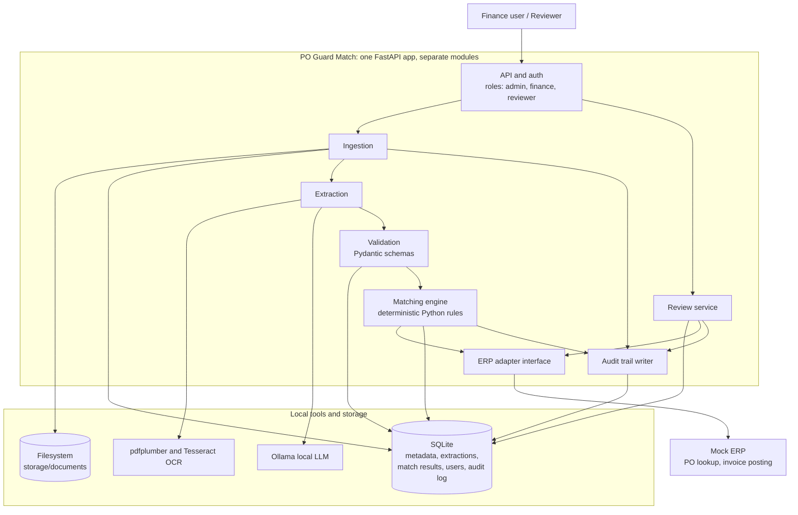

## Component Diagram



## Sequence Diagram

```mermaid
sequenceDiagram
    actor Finance
    actor Reviewer
    participant API as FastAPI
    participant ING as Ingestion
    participant EXT as Extraction
    participant LLM as Ollama
    participant VAL as Validation
    participant MAT as Matching
    participant DB as Database
    participant ERPAdapter as ERP Adapter
    participant ERP as Mock ERP

    Finance->>API: Upload PDF
    API->>ING: Process uploaded file
    ING->>DB: Store PDF and metadata
    ING->>DB: Check SHA-256 hash

    alt Duplicate file
        ING-->>API: Reject duplicate
        API-->>Finance: Duplicate detected
    else New file
        API-->>Finance: Upload accepted
        ING->>EXT: Extract document data
        EXT->>LLM: Structure extracted text
        LLM-->>EXT: Return structured data
        EXT->>VAL: Validate extracted data

        alt Invalid data
            VAL->>DB: Save review required status
        else Valid data
            VAL->>DB: Save extracted data
            VAL->>DB: Save extracted status
        end
    end

    Note over MAT,DB: Matching starts when validated PO, invoice and GRN exist

    MAT->>DB: Load PO, invoice and GRN
    MAT->>ERPAdapter: Request PO and vendor data
    ERPAdapter->>ERP: Look up master data
    ERP-->>ERPAdapter: Return master data
    ERPAdapter-->>MAT: Return master data
    MAT->>MAT: Apply deterministic rules

    alt Rules fail
        MAT->>DB: Save mismatch reasons
    else Rules pass
        MAT->>DB: Save matched pending approval
    end

    Reviewer->>API: Open review queue
    API->>DB: Fetch review cases
    DB-->>API: Return cases
    API-->>Reviewer: Display results

    Reviewer->>API: Approve, reject or correct
    API->>DB: Save reviewer decision

    alt Fields corrected
        API->>VAL: Validate corrected data
        VAL->>MAT: Request matching again
        MAT->>DB: Save updated matching results
    else Approved
        API->>ERPAdapter: Request invoice posting
        ERPAdapter->>ERP: Post invoice

        alt ERP accepts
            ERP-->>ERPAdapter: Posting successful
            ERPAdapter-->>API: Success
            API->>DB: Save posted status
        else ERP unavailable
            ERP-->>ERPAdapter: Posting failed
            ERPAdapter-->>API: Retry required
            API->>DB: Save ERP retry status
        end
    else Rejected
        API->>DB: Save rejected status
    end
  ```